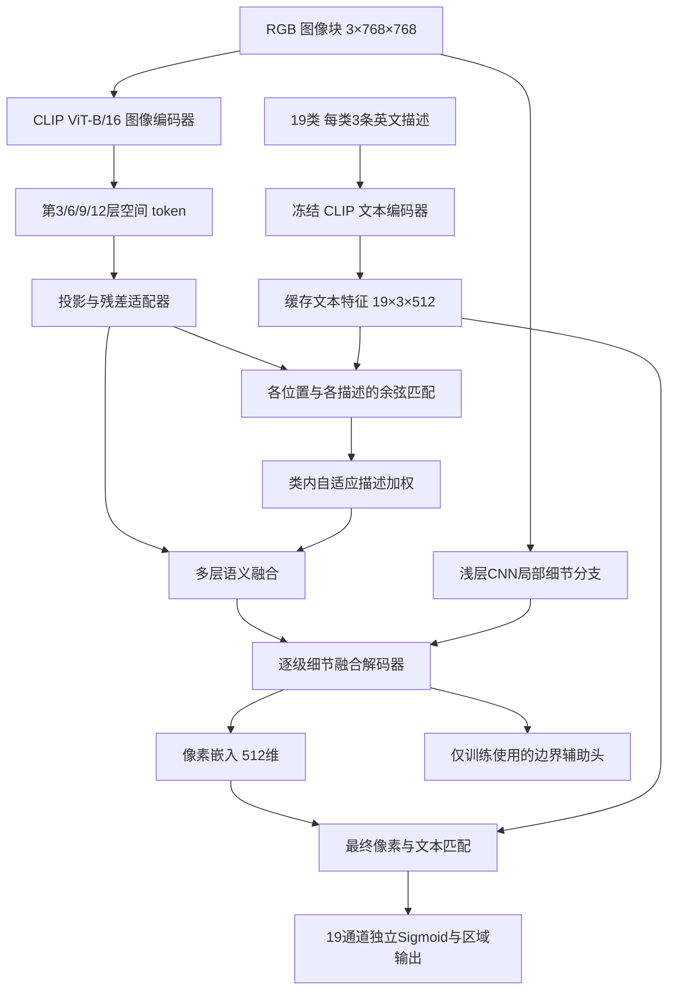

# 基于 CLIP 的桥梁病害多标签语义分割：模型架构与论文实验方案

版本：2026-10-28，研究设计稿。工作名：BridgeTextSeg。

2026-10-29补充：用户提出一个月内形成论文实验数据的期限。本月执行以[30天实验计划](../superpowers/plans/2026-10-29-30-day-experiments.md)为准：统一512输入，18次核心训练，余量允许时补6次；本文的768/36次为完整研究范围，不是本月必须全部完成的任务。

本方案是建议实施的研究设计，不是已完成的模型或已验证的创新成果。当前已完成本地 JSON 数据审计与文献核对，尚未训练模型、测量显存和速度，也没有实验精度结果。所有超参数均为起始配置，调整范围和选择规则应在最终评估前锁定。

## 1. 研究目标与方案选择

目标：输入一张桥梁巡检 RGB 图片，输出每类病害的像素级概率与二值区域，保留同一像素属于多类病害的情况。用户无需在推理时输入文字；类别描述在部署前配置并缓存。

建议论文题目：**基于视觉语言语义对齐与局部细节融合的桥梁病害多标签语义分割方法研究**。

研究问题：

1. 病害外观描述能否为 CLIP 的局部特征提供有用语义，改善易混淆与长尾病害的分割？
2. 在最终预测始终依赖文本匹配的条件下，局部细节分支能否改善裂缝漏检和边界粗糙问题？

可选路线及取舍：

| 路线 | 优点 | 局限 | 本方案决定 |
|---|---|---|---|
| 直接微调 CLIPSeg | 起步快，已有文本条件分割框架 | 需处理多标签输出、细病害与自然图像域差异 | 作为可选参照，不直接当作创新 |
| CLIP 文本像素匹配＋细节解码器 | CLIP 直接决定各类区域，消融清楚，适配现有 mask | 需要改造空间特征提取与解码 | 推荐主线 |
| CLIP＋SAM＋检测器串联 | 提示式系统容易演示 | 模块多，病害细节表现与 CLIP 贡献不易归因 | 不纳入首版 |

技术依据：DenseCLIP 已研究像素与文本对齐；CLIPSeg 已给出 CLIP 加解码器的分割方法；CAT-Seg 已研究图文匹配代价聚合。因此，“使用 CLIP”“添加文字”“多层特征融合”本身不应写成首次提出的贡献。[DenseCLIP](https://arxiv.org/abs/2112.01518)、[CLIPSeg](https://arxiv.org/abs/2112.10003)、[CAT-Seg](https://arxiv.org/abs/2303.11797)。

2025 年已有 [CrackCLIP](https://pmc.ncbi.nlm.nih.gov/articles/PMC11854218/)；2026 年还有 [PCA-Seg 预印本](https://arxiv.org/abs/2603.17520)及[文本引导裂缝分割工作](https://onlinelibrary.wiley.com/doi/10.1155/adce/8268356)。候选贡献必须与这些工作逐项比较，特别区分本方案的多病害、多标签重叠任务与二值裂缝任务。后一篇目前仅取得检索摘要，正式撰写相关工作前仍需阅读全文。

## 2. 已核实的数据，以及需要补充的数据

### 2.1 本地数据事实

数据位置：`D:\dataset\dacl10k`。FiftyOne 导出，图像在 `data/`，所有记录在 `samples.json`。审计结果见同目录的 `dataset_audit.json`，该审计读取全部记录，没有生成全部像素 mask。

| 原始划分 | 图片数 | 非空多边形标注 | 显式空标注 | 缺失标注对象 | 多边形数 |
|---|---:|---:|---:|---:|---:|
| train | 6,935 | 6,873 | 62 | 0 | 54,158 |
| validation | 975 | 966 | 9 | 0 | 8,167 |
| testdev | 1,012 | 0 | 0 | 1,012 | 0 |

`testdev` 的图像尺寸元数据也全部为空，预测时必须从 JPG 实际读取宽高。它没有本地真值，不能算本地 IoU，也不能把 null 标注转换成全零负样本。

训练、验证中的 71 条空记录是存在标注对象但 `polylines=[]`，与 testdev 的 null 不同。准备阶段应逐张查看，并与原始标注核对。默认保留原划分及原标签；只有证据表明标签缺失时，才将其标记为未知并记录原因。不能看到图像“似乎有病害”就自行改写官方验证标签，更不能为提高指标删除空样本。若无法确认训练空样本可靠性，可把“保留/训练时忽略”作为内部敏感性分析，最终评估仍按明确披露的原始标签协议进行。

### 2.2 类别与通道顺序

固定输出 19 通道；前 13 通道为病害，后 6 通道沿用官方分组。主结果同时报告病害 mIoU13 与全部类别 mIoU19。

| 通道 | 标签 | 中文说明 | 官方分组 | 训练集含此类的图片数 |
|---:|---|---|---|---:|
| 0 | Crack | 裂缝 | 病害 | 1,727 |
| 1 | ACrack | 网状裂缝 | 病害 | 332 |
| 2 | Wetspot | 湿斑 | 病害 | 965 |
| 3 | Efflorescence | 泛碱/析出物 | 病害 | 1,523 |
| 4 | Rust | 锈蚀/锈迹 | 病害 | 3,450 |
| 5 | Rockpocket | 蜂窝/骨料间空隙 | 病害 | 311 |
| 6 | Hollowareas | 空鼓标注区域 | 病害 | 1,097 |
| 7 | Cavity | 孔洞 | 病害 | 1,188 |
| 8 | Spalling | 混凝土剥落 | 病害 | 3,262 |
| 9 | Graffiti | 涂鸦 | 病害 | 795 |
| 10 | Weathering | 风化 | 病害 | 2,704 |
| 11 | Restformwork | 残留模板 | 病害 | 713 |
| 12 | ExposedRebars | 钢筋外露 | 病害 | 773 |
| 13 | Bearing | 支座 | 物体/构件 | 730 |
| 14 | EJoint | 伸缩缝 | 物体/构件 | 395 |
| 15 | Drainage | 排水设施 | 物体/构件 | 1,030 |
| 16 | PEquipment | 防护设施 | 物体/构件 | 1,319 |
| 17 | JTape | 接缝带 | 物体/构件 | 767 |
| 18 | WConccor | 冲刷/混凝土腐蚀 | 官方物体组 | 265 |

上述计数是训练集图像出现次数，不是像素数，也不能相加当作图像总数。WConccor 虽名称接近病害，仍按官方通道与分组报告，不自行重排。类别中文译名仅供理解，最终定义以数据说明、原标注和导师/领域人员复核为准。

官方仓库确认多标签任务及通道顺序：[dacl10k-toolkit](https://github.com/phiyodr/dacl10k-toolkit)。原论文 v1 摘要与当前 v2 标签数量存在差别；论文必须说明本实验采用 v2 的 19 类导出，不能把不同版本、不同分辨率或不同测试划分的数字直接比较。

### 2.3 数据准备规则

输入图像 `X:[3,H,W]`；目标 `Y:[19,H,W]` 为 multi-hot 二值张量；另有空间有效掩码 `V:[1,H,W]`。

1. 读取原始图片，以实际尺寸复核 metadata；空间操作对图片和所有标签同步执行。
2. 归一化顶点恢复为连续像素坐标：`x=x_norm*W, y=y_norm*H`。栅格化时约束边界到有效范围，并记录取整与填充规则；不是把比例值直接当作像素。
3. 同类多边形取并集，异类放到独立通道；不能用后画区域覆盖前画区域。
4. 图片缩放可用双线性；二值 mask 用最近邻，或将连续轮廓变换到目标尺寸后再栅格化，并固定一种主协议。
5. 边缘 padding 的位置令 `V=0`，不参与损失或评测。原图中无任何已标类别的有效像素，对 19 通道全为 0；无需第 20 个互斥背景类别。
6. 至少检查 50 张随机叠加图、全部 71 张空标注记录、每类 5 张样本，以及专门选择的跨类别重叠区域。若检查集出现问题，扩大核验范围。
7. 边界标签可由各通道的 mask 形态学梯度自动生成，不需要人工再标边界。边界不确定和填充边缘应使用有效区过滤。

### 2.4 论文还需要准备什么

| 数据/文件 | 是否必须 | 用途 |
|---|---|---|
| 现有图像＋原始多边形 | 必须，已有 | 主训练与评价 |
| 固定的训练/内部调参/最终评估清单 | 必须 | 防止数据泄漏，复现实验 |
| 每类像素比例、图片频次、重叠共现统计 | 必须补算 | 解释类别不平衡与多标签难度 |
| 19 类英文描述，每类 3 条 | 本架构必须 | 输入 CLIP 文本编码器；不要求逐图 caption |
| 描述来源、修订记录、配置哈希 | 必须 | 防止用最终评估集反复修改提示 |
| DeepCrack 等外部图像与像素真值 | 建议 | 只检验裂缝跨数据集迁移，不覆盖所有病害 |
| 独立采集且分组清楚的桥梁测试数据 | 若声称真实跨桥梁泛化则需要 | 验证与训练来源独立的应用表现 |
| 各实验预测、逐类 TP/FP/FN、配置和日志 | 必须 | 生成论文结果，而非只截一张精度图 |

仅使用 dacl10k 也能完成方法研究；如果论文声称“跨数据集泛化”，需要实际完成外部测试。若要声称全部 13 类泛化，需有标签定义兼容的外部多类 mask，单一裂缝数据集不能支持这一结论。

## 3. 无测试泄漏的评测协议

### 3.1 推荐主协议

1. **方案开发**：只在官方 train 的 6,935 张内，按约 90%/10% 分为 `train_inner` 和 `tune_inner`，目标约 6,240/695 张；实际数量以分组和多标签分层约束为准。
2. **冻结决定**：在 tune_inner 上确定模型模块、训练轮数、提示词、阈值与预处理，写入锁定配置。
3. **最终重训**：用全部官方 train，从同一预训练权重重新训练，使用冻结的训练轮数与设置；不能根据最终评估结果挑轮次。
4. **最终本地评估**：对官方 validation 的 975 张评分，按预先注册的完整实验矩阵统一报告，不根据结果继续改方案并仍称其为独立测试。
5. **官方隐藏测试**：如果官方评测服务可用，再按其格式与当前规则提交 testdev 预测；目前没有验证账户、提交可用性或执行提交。没有官方返回值就不报告其 IoU。

论文用语：`官方验证集上的最终本地评估`。它不是本地有标签的官方 testdev。若之后继续利用该 975 张调参，应诚实称为验证结果，并另设独立测试。

### 3.2 分组与重复检查

优先使用真实桥梁/采集批次 ID 分组。如果当前导出没有此类 ID，不得把 `train_1394` 或 `data_0` 当作桥梁 ID。先做 SHA256 完全重复检查，再做感知哈希/相似图候选检查及人工复核；相似度阈值用于提出候选，不能自动推断同桥或直接改标签。

内部划分按重复图组整体分配，并做多标签分层，确保稀有类在两个子集都有覆盖。发现官方 train/validation 间重复时，保留原划分主结果，并补充从训练端去除确认重复后的敏感性结果及清单；不能把重复图片随机拆成独立样本。

主协议不能在事后声称“严格跨桥梁”，除非有来源分组证据。

## 4. 完整模型架构

### 4.1 总体结构

主模型没有绕过文本的自由卷积分割分类头。最终每类分数来自视觉像素嵌入与该类描述的匹配；边界辅助头仅用于训练。

### 4.2 输入和特征尺寸

以下按 `B` 个 768×768 图像块计算，CLIP 采用原始 OpenAI ViT-B/16 权重。对应 12 个视觉 Transformer block，视觉隐藏维 768，共享图文维 512。权重文件版本、来源与哈希应记录。[官方实现](https://github.com/openai/CLIP/blob/main/clip/model.py)

| 部分 | 输出形状 | 说明 |
|---|---|---|
| 输入 | B×3×768×768 | 使用 CLIP 权重对应归一化 |
| patch embedding | B×2304×768 | 48×48 patch，不含 CLS |
| 第3/6/9/12层输出，各一份 | B×768×48×48 | 相同空间分辨率，不是四种原生尺度 |
| 投影适配后的 U_i，各一份 | B×512×48×48 | 对齐图文共享维度 |
| 文本嵌入 T | 19×3×512 | 无须按 batch 重算 |
| 每层类内描述匹配 q_i | B×19×3×48×48 | 对 3 个描述逐一匹配 |
| 每层类别分数 s_i | B×19×48×48 | 只在同类 3 个描述间加权 |
| 语义融合 F16 | B×256×48×48 | 汇集四层特征与四组分数 |
| CNN 局部特征 L4 / L8 | B×64×192×192 / B×128×96×96 | 提供真实高分辨率局部信息 |
| 解码 F8 / F4 | B×256×96×96 / B×128×192×192 | 双线性上采样＋卷积融合 |
| 像素嵌入 E | B×512×192×192 | 最终文本匹配的视觉输入 |
| 主 logits | B×19×768×768 | 1/4尺度匹配后上采样 |

不能直接调用 `encode_image()` 的全局输出来分割。需要提取 patch token，保留 CLS 在 Transformer 内参与计算，但在空间重排时去掉 CLS。官方固定网格位置编码需要对空间部分做二维插值，保留 CLS 的位置编码不变；768 输入对应 48×48 网格。这是实现时必须添加并核验的适配，不能假定原版 CLIP 自动支持。

### 4.3 文本分支：领域外观描述

每类准备 3 条简短、可见外观导向的英文描述：类别常用名称、形态描述、纹理/表面表现描述。避免直接把 ACrack、EJoint、WConccor 等缩写当作有意义的自然语言。

示例 Crack：

1. `a photo of a crack on a concrete surface`
2. `a thin irregular fracture line in concrete`
3. `a narrow branching crack on a concrete surface`

各描述经冻结文本编码器，L2 归一化后得到 `t[k,m]∈R^512`。`M=3`，全部 57 条文本的 token 长度应通过 tokenizer 检查。已附 `class_prompts_draft.json` 作为可复核的57条初稿，尚未由领域专家或训练样本核验，也未用于训练。文本内容只能参考类别定义、训练样本和领域知识，不能查看最终评估预测后反复修改。描述没有为图像补充真实测量或隐藏诊断信息。

Hollowareas 可能涉及无法仅凭 RGB 直接判断的内部状态。描述应依据训练图中实际可见的表面或巡检标记，不能写成“模型能从照片确诊内部空鼓”。其他类别也只承诺复现数据集的可见标注任务。

### 4.4 图像特征适配与候选模块一

对层 `i∈{3,6,9,12}`，先对 patch 隐藏向量作 LayerNorm，再使用 CLIP 视觉投影 `Wclip:768→512`。该投影与其预训练参数在主配置中保持冻结。接残差适配器：

`U_i = normalize(F_i + A_i(F_i))`

`A_i: Linear(512,64) → GELU → Linear(64,512)`，末层零初始化；四层适配器不共享参数。这里把全局投影用于 patch 特征只是初始化方式，不声称原始 patch 已天然与文本精准对齐；像素监督负责进一步适配。

描述匹配：

`q[i,k,m,u] = cosine(U_i(u), t[k,m])`

`alpha[i,k,m,u] = softmax_m(beta_i * q[i,k,m,u])`

`s[i,k,u] = gamma_i * sum_m(alpha[i,k,m,u] * q[i,k,m,u]) + b[i,k]`

其中 `u` 是空间位置。`beta_i`、`gamma_i` 为正可学习标量，初值分别 5、10，范围限制为 [1,20]、[1,100]；`b[i,k]` 是可学习类别偏置，初值 -2。归一化只在每类自己的 3 条描述上进行，**不对 19 类做互斥 softmax**。

目的：同一类别可表现为不同外观，允许不同位置采用不同描述权重。研究中必须对比“类别名称”“领域描述固定平均”“领域描述自适应加权”，才能知道收益来自描述还是加权机制。该机制与现有多提示匹配方法的区别仍需进一步文献审查。

### 4.5 多层语义融合与候选模块二

四个 `U_i` 分别经 1×1 卷积从 512 降到 128 通道，拼接后为 512 通道；四个 `s_i` 共 76 通道。拼接为 588 通道，经 1×1 卷积、GroupNorm、GELU 变为 256 通道，得到 F16。

浅层 CNN：

`3→32 (stride2) →64 (stride2) →64 (stride1)` 产生 L4；

`64→128 (stride2) →128 (stride1)` 产生 L8。

卷积均为 3×3、padding1，除最后像素投影外均接 GroupNorm 和 GELU。以 8 个组为默认，所有通道可整除。该分支从头训练。

解码：

1. F16 上采样到 1/8，拼接 L8；两个 3×3 卷积，`384→256→256`，得到 F8。
2. F8 上采样到 1/4，拼接 L4；两个 3×3 卷积，`320→128→128`，得到 F4。
3. F4 经 1×1 卷积 `128→512`，对 512 通道做归一化，得到 E。
4. 使用与上式相同的类内描述匹配规则计算最终类别 logits，使用单独的可学习 beta/gamma/b 参数；将 logits 双线性上采样到输入分辨率。

去除局部分支的消融中，以只依赖 F16 的同级上采样卷积替代，不引入 L4/L8。报告其参数量差异；提升不能仅归因于“更大模型”，还应结合匹配容量的纯视觉对照判断。

目的：CLIP 负责语义匹配，浅层卷积补充细线与边缘信息。最终分类仍依赖文本嵌入，不能把 CLIP 降格为仅生成一段事后描述。

### 4.6 损失与训练参数

所有 19 通道独立使用 sigmoid；不使用互斥交叉熵和 argmax。

`L_main = BCEWithLogits(L,Y;V) + Dice(sigmoid(L),Y;V)`

`L_total = L_main + 0.2 * L_coarse + 0.1 * L_edge`

定义如下：

- BCE 对有效像素与类别取平均，主配置不设类别权重，避免叠加过多机制。后续若测试加权，只能从当前训练子集计算，所有对照用相同策略。
- Dice：固定为逐图、逐类计算，每张图仅对有正真值的类别平均，再对图像平均。真值为空的类别不计算 Dice 项，但仍由 BCE 惩罚假阳性；一张图没有任何正真值时该图 Dice 项为 0。平滑常数为 1e-6。不跨microbatch合并Dice统计，避免更改microbatch时改变其定义。边界Dice使用同一规则。
- L_coarse：将四个 s_i 分别上采样到输入尺寸，与原始多标签目标计算有效像素 BCE，再对四层平均。避免用最近邻把细裂缝降采样成全零目标。
- L_edge：F4 上添加 `128→19` 的 1×1 边界头，上采样后使用 BCE＋Dice。边界真值为每类 mask 的 3×3 膨胀减腐蚀；过滤无效区和紧邻 padding 的位置。边界头在推理时移除。

边界损失、BCE/Dice 和解码器都是常用技术，不单独宣称首创。`0.2/0.1` 是起始值，可在内部调参集测试 `{0,0.1,0.2}` 及 `{0,0.05,0.1}` 的有限组合；搜索预算需记录，不能无限反复尝试。

可训练参数：四层适配器、融合与解码卷积、浅层 CNN、匹配标量与偏置、边界头；第 6 个 epoch 起再解冻 CLIP 图像编码器最后 2 个 block。其余 CLIP 图像参数、原投影及全部文本参数保持冻结。冻结段前向不建梯度图，但后续可训练适配器和最后两层必须保留正常梯度。

### 4.7 推理输出

1. 只读取图片，文本特征预先缓存。
2. 按训练一致的规范缩放、分块，预测 19 类 logits。
3. 重叠区域对 logits 求均值，取消 padding，再将 logits 恢复到原图尺寸。
4. 每类独立 sigmoid，主阈值统一为 0.5；阈值敏感性仅在内部调参集完成。
5. 输出 19 个概率/二值 mask；产品展示默认显示 13 类病害，也可展示其余类别。
6. 从 mask 提取连通区域可用于可视化轮廓或框，但不等同于训练了实例分割模型。

不要求额外整图分类头。若界面需要列出病害名称，应根据预测区域生成；最小面积过滤只能在内部数据定规则，主论文像素指标默认不进行此类后处理，避免掩盖细裂缝漏检。

本任务是监督多标签分割。没有另设未见类别协议时，不能称为零样本、开放词汇或未知病害识别；有概率图也不意味着已完成可靠性校准。

## 5. 针对 AutoDL RTX 4090 的训练配置

环境以用户提供配置为准：Ubuntu22.04、Python3.10、PyTorch2.1.0、CUDA12.1、RTX4090 24GB×1、16vCPU、120GB RAM。torchvision 建议与 torch 配套为 0.16.0；官方有该组合的 CUDA12.1 安装版本。[PyTorch 版本说明](https://docs.pytorch.org/get-started/previous-versions/)

| 项目 | 主配置起点 | 备注 |
|---|---|---|
| patch 输入 | 768×768 | 先用 512 做短跑；所有正式对比固定同一设置 |
| 训练图像 | 保持比例，基础最长边 1536，再乘 [0.75,1.25] 随机尺度 | 不把所有图片直接压到 224 |
| 训练裁剪 | 768×768 | 短边不足时 padding，有效区屏蔽损失 |
| 裁剪采样 | 50% 均匀，50% 以随机已标注病害像素为中心 | 无病害图片退回均匀裁剪；保留背景负区域 |
| 数据增强 | 水平翻转 p=.5，垂直翻转 p=.5，小幅亮度/对比度扰动 | 方向性描述不进入默认提示；所有模型相同 |
| batch / 累积 | 正式microbatch=1，累积8次，每8张图更新一次 | 正式对比统一该设置；不是把跨批Dice视为等价 |
| 精度 | AMP FP16＋GradScaler | 损失和归一化的关键统计用 FP32 |
| 优化器 | AdamW，weight decay=.01 | bias 和归一化参数不衰减 |
| 新模块学习率 | 1e-4 | 起点，不预设它必然最优 |
| 最后2个 CLIP block 学习率 | 1e-5 | 前 5 epoch 不解冻 |
| 训练轮数 | 80 epoch | 内部短跑后可锁定为 80/120 之一，不在最终评估上挑选 |
| 学习率计划 | 前5 epoch线性 warmup，其后 cosine 到初始值1% | 解冻组在epoch6开始单独短warmup到目标LR |
| 梯度裁剪 | global norm=1.0 | 记录非有限梯度情况 |
| 随机种子 | 17、42、2026 | 共享同一数据划分，不用最优seed代表整体 |
| DataLoader workers | 起点8，内部测4/8 | 16vCPU不代表workers越多越快 |
| checkpoint | 开发集按最佳内部mIoU13选；最终重训按锁定轮数 | 不用官方validation挑最终checkpoint |

512 短跑与 768 主实验的特征尺寸不同，前者不直接混进主表。任何 OOM 引起的统一输入修改必须对全部模型重做，不能只给 proposed 使用更高分辨率。B1的预训练BatchNorm固定running mean/variance，可训练其仿射参数；其余小批量新增卷积使用GroupNorm。梯度累积不能修复BatchNorm或跨批Dice的差异，因此正式实验固定microbatch=1，不用模型各自选择的microbatch掩盖差异。

### 5.1 验证分块与统一评分

主评测先把图像保持比例缩放至最长边 1536，按 768 窗口、512 步长滑窗，短边 padding 到足够窗口大小。最后一个窗口贴齐边界；重叠 logits 等权平均，每个有效像素必须被覆盖。之后恢复原尺寸，按原尺寸真值汇总主 IoU/Dice。

这是一套本研究的统一评分协议，不等于原论文曾使用的分辨率设置。与文献公开数字直接比较前，需要复现同一版本、分辨率和评测方式。比较 512/768 时，二者图像基础最长边同为1536，改变窗口及步长（512窗口步长约341，768窗口步长512），并记录计算量变化。

主表不使用测试时翻转增强、不使用 CRF，不按模型单独调阈值。可选增强需另表报告。

### 5.2 存储和运行测量

50GB 数据盘的主要限制是缓存和 checkpoint。仅 7,910 张有标注图片，如果全部存为 19×768×768 的 uint8 密集 mask，不压缩约 88.6GB（十进制），已经超过数据盘；float32 更大。

建议保留原始 JPG/JSON，按需对当前图片或裁剪栅格化，在 RAM 中设置有界缓存；不保存全量多通道浮点 mask。需要落盘时按像素 bit-pack 或压缩分片，并先用一小批实测压缩率和解压开销。磁盘缓存上限先设 8GB，不据估计一次写满。

公共预训练权重只保留一份；每个实验保存最佳可训练参数及完整配置，当前运行再保存一个用于恢复的 last checkpoint（含 optimizer/scaler/RNG）。仅保存可训练参数时必须同时记录基础权重的来源与 SHA256。不要存每一轮的完整概率图。将已完成的结果表与必要 checkpoint 归档，日志不替代备份。

训练前分别做两种状态的200步短跑：完全冻结CLIP的开发状态，以及已解冻最后两层的正式状态。每一种都包含真实前向、反向、optimizer.step和GradScaler更新；前50步warmup确保AdamW状态已分配，再测150步的平均迭代时间、峰值显存与数据等待时间。对P、B4和B5分别执行其实际训练策略；B5若原生策略训练更多注意力参数，必须测其真实梯度图，不能拿P的显存估计代替。

优先使用激活检查点和CLIPSeg的提示分块降低显存；若仍无法在24GB上以统一768配置运行，则在最终评估前将主矩阵全部改为512，并披露决定与实际配置。由实际epoch迭代数估算总训练时长，冻结期与解冻期分开估算，再加实测评估耗时。估计不能当作完整训练实测。当前没有进入AutoDL执行。

## 6. 实验矩阵及每项实验的目的

### 6.1 主对比：模型是否值得使用

所有主模型训练 19 个独立 mask；同样的数据清单、增强、分辨率、预处理、损失主项和评分程序；各模型可以在相同预算内选择适合的学习率，需公开搜索范围。

| ID | 模型 | 目的 |
|---|---|---|
| B1 | DeepLabV3+，ResNet50，ImageNet预训练 | 与成熟 CNN 分割方法比较 |
| B2 | SegFormer-B2，ImageNet预训练 | 与强 Transformer 分割方法比较 |
| B3 | CLIP ViT-B/16＋同样的适配/解码结构，但使用随机初始化的可学习类别原型代替文本 | 分离 CLIP 视觉预训练与文本语义的作用 |
| B4 | 适配为19通道独立预测的 CLIPSeg | 与已有 CLIP 分割框架比较 |
| B5 | 适配为多标签监督的 CAT-Seg ViT-B/16 | 与更强的图文匹配方法比较，建议完整论文保留 |
| P | BridgeTextSeg 完整模型 | 判断主问题是否获得改进 |

B3 的原型为 `19×3×512`，匹配维度、空间分支、边界监督与最后两层解冻策略均与 P 一致。它允许学习类别向量，因此不是故意削弱的随机固定文本对照；记录多出的可训练原型参数。也可补充普通卷积分类头对照，但不能代替 B3。

B4/B5 原方法多为不同任务设置，改造后的结果必须写成“本研究多标签适配复现”，不得冒充论文原表数字。标明额外预训练数据、初始化及训练预算；如使用公开分割预训练权重，应另列，并为其他模型提供合理对照。不同预训练来源的差异必须在解释中说明。

**B4/B5主表适配锁定规则：**

- 来源分别为[CLIPSeg官方仓库](https://github.com/timojl/clipseg)和[CAT-Seg官方仓库](https://github.com/cvlab-kaist/CAT-Seg)。实现阶段第一次取得代码后立即固定commit并记录；提交号当前未取得，不编造。最终配置锁定前必须填入实际commit和适配补丁哈希。
- 两者都只加载同来源的OpenAI CLIP ViT-B/16图文预训练参数，解码器随机初始化。不使用PhraseCut/COCO/ADE训练过的分割checkpoint参与主表；如需比较其迁移效果，另设扩展表。
- B4采用`CLIPDensePredT(version='ViT-B/16', reduce_dim=64, extract_layers=(3,6,9), cond_layer=0, n_heads=4, n_tokens=None, complex_trans_conv=True)`。这里extract_layers是官方代码的零基索引，即第4/7/10层，不与P的第3/6/9/12层混写。保留原生CLIP全冻结策略，训练FiLM、特征降维、Transformer解码器和上采样头；每类输入其固定class_name_prompt，得到一个独立logit图。
- B4每张图只运行一次冻结图像编码器，共享patch特征；19个文本条件按1个一组解码、计算逐类损失并累积梯度，避免把同一图片编码19遍或同时保留19份大图。由于损失逐图逐类可加，按预先已知的有效类别数和19通道BCE归一化后，可实现与一次性19通道损失相同的梯度；须在小样本上验证。原生代码直接重复forward的低效方式不作为速度结论。
- B5以官方CVPR版本的`configs/vitb_384.yaml`为结构起点，保持hidden_dim128、聚合层数2、heads4、decoder_dims[64,32]，类别改为19。主表将图像实际编码分辨率改为768，特征网格从24×24改为48×48，空间window12，位置编码相应插值；必须同时修改模型内固定的`clip_resolution`，不能只改外部crop后仍在内部压回384。保留官方attention微调策略：图像与文本Transformer的Q/V投影及代码原定义的可训练位置参数参与训练，其他CLIP参数冻结；新增模块LR起点1e-4，CLIP组LR起点1e-6。训练期间重算变化中的文本特征，推理才缓存。
- B4/B5都用19通道独立sigmoid及本方案同定义的主BCE＋逐图Dice，取消原任务互斥分类损失。B5训练可能仍有内部按类别归一化的聚合机制，但最终输出/监督不能变成互斥softmax。原方法内部归一化及类别交互不随意删除。
- B4冻结策略和B5微调策略与P不同，保留这种原生差异并报告参数和成本；语义因果解释主要依据严格匹配结构与解冻方式的B3，而不是仅凭P战胜B4。B4/B5均先通过768全梯度短跑，必要时统一降分辨率；不能悄悄减少其真实输入像素。

主表对 B1、B2、B3、B4、B5、P 各运行3个seed，共18次最终重训。开发阶段先各跑seed42，确认可行后再补齐重复。硬件预算允许并不代表应无目的增加模型。

### 6.2 模块消融：提升来自哪里

下列所有消融使用同一个 CLIP 初始化、四层输出、训练解冻与主损失；L_coarse统一保留。内部调参阶段完成，不根据最终975张再筛选组合。

| ID | 文本表示 | 局部分支 | 边界监督 | 目的 |
|---|---|---|---|---|
| A0 | 类别名称，3条相同描述，固定平均 | 无 | 无 | 基础文本像素匹配 |
| A1 | 领域3描述，固定平均分数 | 无 | 无 | 领域描述的作用 |
| A2 | 领域3描述，类内自适应加权 | 无 | 无 | 自适应描述匹配的作用 |
| A3 | 类别名称，固定平均 | 有 | 无 | 在基础语义下检验细节分支 |
| A4 | 领域3描述，自适应加权 | 有 | 无 | 两个候选模块结合后的表现 |
| A5=P | 同A4 | 有 | 有 | 边界监督是否提供额外收益 |

为避免把“描述改善”与“自适应改善”混为一谈，可再加 `A1L=领域3描述固定平均＋局部分支、无边界`。A0/A2/A3/A4 组成语义模块与局部分支的2×2组合；A1/A1L用于解释静态描述的收益。

首轮在内部划分单seed运行7种配置；正式论文对计划报告的消融至少做3seed，并在锁定矩阵后统一评分。A5与主表P相同的配置和seed可复用一次训练结果，不重复浪费计算。实验表应注明各结果属于内部开发还是最终评估，不把两种划分的数放同一列。

**预定核心矩阵固定为12种独立配置：B1–B5、P、A0–A4、A1L，各3seed，共36次最终训练。A5是P的别名，不另训。** 阶段性内部开发和超参数搜索不计入这36次。扩展优先顺序为：外部裂缝推理、文本稳定性和资源测试；其次少标注量曲线；再做13/19类及输入分辨率对照。哪些扩展进入最终975张评分，必须在首次最终评分前锁定；不能看完分数再挑有利的实验。

用户说明费用不是约束，因此不人为设未经授权的金额上限。仍需在真实解冻短跑后给出36次核心训练的GPU小时估计和扩展工作量；发现软件或硬件无法实现时，先记录技术原因并在内部开发阶段修订矩阵，而不是在结果表中无声省略强基线。

### 6.3 专门验证 CLIP 关联

1. P 对 B3：固定结构下真实文本语义是否优于从头学习的原型。
2. A0→A1→A2：类别名称、领域描述、加权方式是否逐步有益，允许出现非单调结果。
3. 单独比较最后层特征与四层特征，文本和局部条件不变；检验多深度特征是否必要。
4. 对锁定后的模型，用预先准备的同义改写描述评估稳定性；只作为文本敏感性分析，不用结果选择最终提示。
5. 推理时打乱文本类别可作为依赖性检查，但性能下降本身不能证明语义创新；主证据仍是公平重训的 B3 与描述对照。

不建议只做“去掉 CLIP 后大幅下降”：这可能同时改变了预训练、模型容量和输入分辨率，无法归因。

### 6.4 扩展分析

| 实验 | 具体操作 | 要回答的问题 | 可支持的结论边界 |
|---|---|---|---|
| 少标注量 | 从train_inner按组、多标签分层建立嵌套10%/25%/50%/100%子集；B2/B3/P同清单，同训练迭代预算 | 文本先验在标签较少时是否有优势？ | 标注效率，不等同于标准few-shot任务 |
| 长尾类别 | 只按train_inner或最终训练集频次，预先固定稀有类组；逐类报告 | 平均提升是否只来自大类？ | 需同时看置信区间和像素规模 |
| 小面积区域 | 按每个图像-类别的真值面积占比，分<0.1%、0.1%–1%、≥1%；整张该类mask计TP/FP/FN | 小病害是否更易漏检，模块是否帮助？ | 语义区域分析，不是实例AP；同时披露类分布混杂 |
| 重叠区域 | 从真值定义至少2类同时为正的像素，分病害/病害、病害/物体统计 | 是否保留了原始任务的标签重叠？ | 同时报告全图与非重叠区域，不能只报容易子集 |
| 13类/19类训练 | B2与P均各做13类训练，与对应19类模型比较共同13类 | 额外类别监督是否有帮助？ | 本数据的辅助监督效应，不能推断所有桥梁构件关系 |
| 输入分辨率 | B2/P比较512与768，保持基础最长边与其他设置一致 | 提升来自模块还是更多像素？ | 同时报告速度、显存 |
| 扰动鲁棒性 | 固定gamma=0.7/1.3、模糊sigma=1/2、归一化像素噪声sigma=.03；不改真值、不重新调参 | 对图像退化是否敏感？ | 合成退化鲁棒性，不等同真实跨桥梁泛化 |
| 外部裂缝测试 | 仅用dacl10k训练，直接评估DeepCrack官方test图像及mask；不使用其train或test调参 | 裂缝是否跨数据集迁移？ | 只支持裂缝结论 |

少标注量实验采用训练集比例与分层规则，不硬凑每类固定样本数。不同数据量固定优化步数；学习率/解冻以总步数比例定义，使比较反映可用标签量，而非一个配置刚好训练更久。补充报告固定epoch结果可作为另一问题，但不得混用。

外部测试前先用文档和少量仅用于定义核对的样本明确标签映射，不查看测试分数再选映射。若 DeepCrack 的裂缝定义覆盖普通与网状裂缝，预注册 `P_crack=max(P_Crack,P_ACrack)`；若定义仅对应普通裂缝则用 Crack 单通道，并解释原因。外部标签定义核对材料不参与拟合；若无法确定，分别报告两种固定映射且不择优。来源：[DeepCrack 官方数据与说明](https://github.com/yhlleo/DeepCrack)。

## 7. 指标、统计与论文需要保存的实验数据

### 7.1 主指标

每个类别独立累计整个评估集合的 TP、FP、FN，之后计算：

`IoU_k=TP_k/(TP_k+FP_k+FN_k)`；

`Dice_k=2TP_k/(2TP_k+FP_k+FN_k)`；

`mIoU13=mean(IoU_0,...,IoU_12)`，`mIoU19=mean(IoU_0,...,IoU_18)`。

同时报告逐类Precision、Recall、Dice/F1。不要把逐张IoU简单平均替代数据集累计IoU，也不要用背景占比主导的像素准确率作为主结论。某类在整个集合并集为0时，标为N/A并说明宏平均有效类数，不人为记满分。

边界F1作为补充：把预测和真值统一到最长边1536的评估尺度，预设2像素边界匹配容差；注明该指标分辨率，与原尺寸主IoU区别。补充裂缝IoU/Recall和重叠像素Recall；重叠Recall按真值正标签计数，不把未标标签强加为假阴性。

### 7.2 随机性与显著性

- 主结果报告3seed均值±标准差，以及每个seed结果；不选最优seed。
- 对P与强基线的逐图TP/FP/FN，做配对bootstrap：同一批重采样单位用于双方，重新汇总计数再算mIoU差，建议2000次。
- 有可靠桥梁组时按桥梁组重采样；没有分组时只能按图片，并注明相关样本可能使区间偏窄。
- 可分别报告各seed的配对区间，并把seed间波动另列；不要把图片bootstrap区间当作包含训练随机性的总体区间。
- 若只提高某些类而平均不稳定，如实报告，不写“全面优于”。目标不是预先承诺某个绝对精度。

### 7.3 速度与资源

在同一4090、同AMP设置、batch1下，固定768×768输入，warmup50次、正式200次，计时前后CUDA同步，报告均值或中位数和P95，注明是否包含预处理。单块FPS与完整原图滑窗耗时分开报告；只测单块不能声称整图实时。

保存总参数量、可训练参数量、训练峰值显存、推理峰值显存、每epoch时长、总训练时长。MACs/FLOPs需要说明输入和统计工具，对文本特征预计算是否计入作说明。

### 7.4 论文证据清单

| 图表 | 数据来自哪里 | 对应论点 |
|---|---|---|
| 数据划分表 | 固定split manifest与审计 | 实验边界清楚 |
| 类别图片/像素分布图 | 训练数据统计 | 长尾与前景背景不平衡 |
| 类别重叠矩阵与示例 | 多标签mask交集统计 | 不能用互斥分割替代 |
| 总体架构图与尺寸表 | 第4节 | 结构可复现 |
| 主模型对比表 | B1–B5、P的3seed | 方法整体表现 |
| 19类IoU表，重点13类 | 每类TP/FP/FN | 哪些病害获益、哪些失败 |
| 消融表与置信区间 | A0–A5、A1L | 模块贡献与交互 |
| 文本对照表 | B3/A0/A1/A2/P | CLIP文本语义确实相关 |
| 少标注量曲线 | 10/25/50/100%实验 | 标注效率 |
| 分辨率/速度/显存表 | 同机实测 | 性能与计算代价 |
| 外部测试或退化表 | 锁定外部协议 | 指定范围的鲁棒性 |
| 成功与失败案例 | 预选ID或固定抽样，不只挑最好 | 机制解释与局限 |

每条实验记录至少包含：实验ID、seed、数据清单哈希、标签顺序、prompt文件哈希、基础权重哈希、预处理、训练与推理设置、模型权重路径、代码版本、逐类计数和资源实测。配置清单见 `experiment_matrix.csv`，空白结果表为 `results_template.csv`，完整运行记录为 `run_record_template.json`。模板中的空结果不是已完成实验。

## 8. 按顺序执行的实验步骤与验收点

| 步骤 | 做什么 | 目的 | 完成时应拿到的东西 |
|---:|---|---|---|
| 1 | 核验标注、71条空记录、通道顺序、原尺寸、来源版本 | 先排除数据问题 | 审计表、人工核验记录、50张以上叠加示例 |
| 2 | 栅格化小样本，统计像素比例与重叠，建立内部划分 | 明确任务与防止泄漏 | 固定清单、像素分布、重叠矩阵 |
| 3 | 整理并复核57条英文描述 | 给文本分支稳定且可解释的输入 | prompt JSON、token长度、来源与哈希 |
| 4 | 先实现B2与A0，选择覆盖不同病害的16张进行过拟合 | 验证加载、梯度、坐标和输出通道 | loss明显下降、预测贴合标注、各类梯度与shape检查 |
| 5 | P/B4/B5按实际策略分别做冻结及可训练状态短跑，均含optimizer更新 | 检验4090配置与数据加载瓶颈 | 实测资源记录、共同microbatch及输入配置 |
| 6 | 内部划分运行B1/B2/B3/A0开发基线 | 确认强基线及CLIP基本可行性 | 开发集逐类指标和失败样本 |
| 7 | 依次运行A1、A2、A3、A4、A5及A1L | 分离语义、细节、边界作用 | 完整内部消融结果，保留负结果 |
| 8 | 完成B4/B5多标签复现，限定预算微调超参数 | 防止只与弱基线比较 | 同协议复现表、配置、限制说明 |
| 9 | 在内部数据完成少标注、分辨率、文本稳定性等预定分析 | 决定论文保留哪些结论 | 锁定实验清单、固定提示和超参数 |
| 10 | 冻结设计，全部官方train重训主模型与核心消融，3seed | 消除内部留出对最终训练数据量的影响 | 最终权重、3seed训练日志 |
| 11 | 对官方validation统一评分；外部集按预注册协议评分 | 形成可信最终证据 | 主表、逐类表、区间、外部结果 |
| 12 | 做统一速度测量与可视化，分析失败 | 解释收益、代价与边界 | 资源表、定性图、失败分类 |
| 13 | 对照相关工作写方法与结果，核查结论与证据 | 完成论文叙述 | 可复现附录、数据/模型引用、局限 |

16张过拟合是诊断，不是精度实验；不规定必须达到某个虚构的98%。若损失不降或区域错位，暂停大规模训练，先检查mask、坐标变换、冻结参数和sigmoid/softmax使用。

若领域描述不优于B3/A0，应首先检查描述定义和数据域匹配，并把改动只放在内部开发阶段。若一致无收益，不强行把文本写成核心贡献；可以缩小问题到明确获益的病害/少标注情形，或更换方法。若细节分支有效而文本无效，结论只能支持视觉细节改进。

## 9. 论文结构与贡献表述

建议章节：绪论；相关工作与理论；数据与任务协议；所提分割方法；实验与分析；总结和局限。架构可拆为“领域文本匹配”与“局部细节恢复”两个技术部分，但不必为凑章节强行制造两个独立模型。

候选贡献的合格写法应包含“具体问题、具体机制、对照证据”，例如：针对多病害外观差异，研究类内描述匹配；针对低分辨率语义特征造成的细节丢失，研究保留文本判别的局部融合。是否能写成新方法贡献，取决于文献差异与实验，而不是模块命名。

不得据本方案直接声称：首次将CLIP用于病害分割、无需标注、零样本识别、所有未见病害泛化、从单张RGB图确定内部结构损伤、没有尺度标定就得到真实裂缝毫米宽度、或在未实测时保证达到某个精度/FPS。

当前交付：完整架构与实验设计、真实JSON审计及记录模板。下一阶段才是模型代码、数据转换实现和AutoDL训练。
